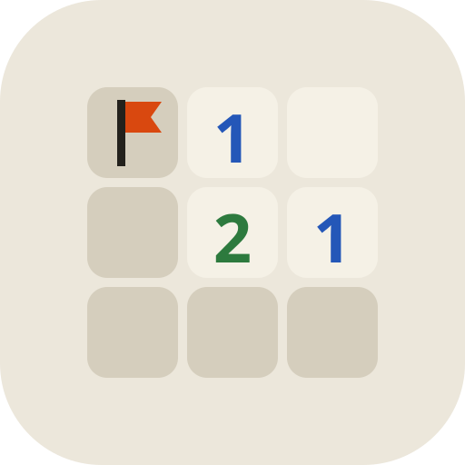
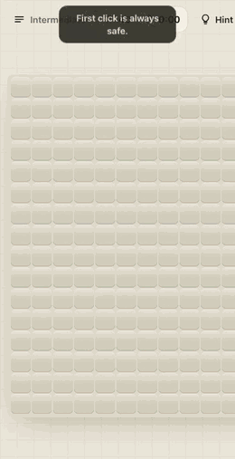
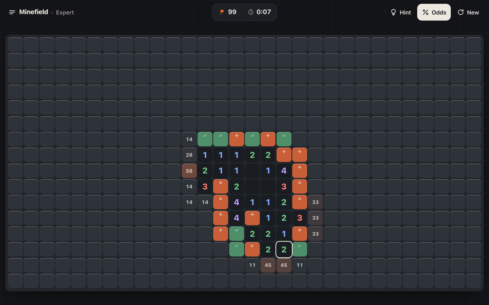

<p align="center">
  
</p>

<h1 align="center">Minefield</h1>

<p align="center">
  Minesweeper for the browser, where every board can be cleared by logic and the solver that proves it also gives the hints.
</p>

<p align="center">
  <a href="https://github.com/AshwinSathian/minefield/actions/workflows/ci.yml"></a>
  <a href="LICENSE"></a>
  
  
</p>

<p align="center">
  <a href="https://minefield.ashwinsathian.com"><b>Play it at minefield.ashwinsathian.com</b></a>
</p>

<p align="center">
  
  &nbsp;
  
</p>

## Features

**The boards**
- Beginner, Intermediate, Expert and Custom sizes up to 60 × 40.
- No guessing, on by default: a board is only dealt after the solver has cleared it from your first click without guessing. Turn it off for classic boards, where the first click is still always safe.
- Daily: one no-guess Expert board per UTC day, the same for everyone. Share your time as text.
- Send any board as a link. The mine layout and start cell are packed into the URL fragment, and the board opens around a ringed start cell.

**Help when you want it**
- Hint finds a move you can be sure of and rings the numbers that prove it, with one sentence on why. It points out a flag that's on a safe cell before anything else.
- Odds shades every hidden cell by its exact chance of being a mine.
- After a loss, the game tells you whether a safe move was open (and outlines it) or whether you were forced to guess, and what your odds were. You can take the move back.
- Games that used any of these don't count toward best times.

**The rest**
- 3BV, 3BV/s, clicks and efficiency on every win; best times, win rate and streaks per mode.
- Large boards turn upright on a portrait screen, so a 30 × 16 Expert board is 16 wide on a phone.
- Your game is saved after every move and the timer stops while the tab is hidden.
- Light and dark themes, synthesised sound, installs as an app and plays offline.

## Controls

| | Mouse | Touch | Keyboard |
|---|---|---|---|
| Open a cell | Left-click | Tap (with the Dig tool) | Space or Enter |
| Flag | Right-click | Long-press, or tap with the Flag tool | F |
| Open around a number | Click the number | Tap the number | Space on the number |
| Move | | Pinch to zoom, drag to scroll | Arrow keys |
| Hint · odds · new game · take back | | Buttons | H · O · N · U |

The board is an ARIA grid with one tab stop. Cells are announced by state, row and column, and moves are read out through a live region.

## How it's built

TypeScript and Vite with no runtime dependencies. The build inlines everything into one HTML file of about 21 KB gzipped. There are no fonts or images to fetch: the type is the system's rounded face, and the flag and mine are CSS masks.

**The solver** (`src/solver.ts`) takes only what a player can see and returns every cell that is certainly safe or certainly a mine, the reason for each, and the exact mine probability of every hidden cell. It works in layers, cheapest first: single numbers, pairs of overlapping numbers, then an exhaustive count of every mine arrangement on each frontier component. Components are combined with the unexplored interior through binomial weights in log space, so the total mine count is used and 60 × 40 boards don't overflow. Certainty is decided from which mine totals are feasible, as integers, never from the floating-point probabilities, which only drive the shading.

**Dealing** (`src/gen.ts`) places mines at random around the first click, has the solver play the board, and deals again if it gets stuck. It runs in an inline Web Worker. On an M-series laptop an Expert board takes 2.5 ms at the median and 45 ms at worst over 100 deals (`npm run bench`). The PRNG is a seeded sfc32, so the Daily board comes from the date with no server.

**How often each layer matters** (`scripts/layers.ts`, 1,000 random boards each, start in the centre):

| | No-guess | Of those, needed full enumeration |
|---|---|---|
| Beginner | 89.7% | 186 of 897 |
| Intermediate | 73.2% | 309 of 732 |
| Expert | 15.8% | 141 of 158 |

A generator with only the single and pair rules would accept 17 Expert boards in 1,000.

**The board** is one CSS grid of plain elements with a single set of pointer listeners. A move only re-renders the cells it changed. Opening animations are staggered by each cell's breadth-first distance from the click, passed in a CSS custom property, so no script runs per frame.

**Speed.** On the live site with a phone viewport, the CPU slowed 4× and 150 ms of network latency, first contentful paint is at about 350 ms and the first tap on an Expert board (deal included) is painted within 80 ms (`scripts/perf.ts`).

## Getting started

Needs Node 24 or later (the tests run TypeScript directly).

```sh
git clone https://github.com/AshwinSathian/minefield.git
cd minefield
npm install
npm run dev       # http://localhost:5173
npm test          # solver against brute force, no-guess boards won by hints, codec, take-back, colour contrast
npm run build     # type-check and build dist/index.html
```

Deploying uses Cloudflare Workers static assets: `npm run deploy` builds and runs `wrangler deploy`. Change `account_id` and `routes` in `wrangler.jsonc` to deploy to your own account.

## Project layout

| Path | What's in it |
|---|---|
| `src/solver.ts` | Deductions, exact probabilities, reasons |
| `src/gen.ts`, `src/worker.ts` | No-guess dealing, the Daily seed, the worker that runs it |
| `src/board.ts` | Neighbours, seeded PRNG, 3BV, the share-link codec |
| `src/game.ts` | Rules, timing, take-back, loss review, hints, save and load |
| `src/main.ts`, `src/style.css` | Board rendering, input, menus |
| `src/store.ts`, `src/audio.ts` | Settings and stats in localStorage; synthesised sound |
| `src/solver.test.ts` | Tests |
| `scripts/` | Benchmarks and browser checks, below |
| `public/` | Icons, manifest, service worker, cache headers |
| `docs/PLAN.md` | The plan the game was built from |

## Benchmarks and checks

- `scripts/bench.ts` times no-guess dealing per size. `scripts/layers.ts` counts how often each solver layer is needed.
- `scripts/flow.ts` plays in a browser: an Intermediate game won by following hints, an Expert loss with its review and take-back, resuming after a reload, the Daily board twice, and a shared link.
- `scripts/media.ts` records the README GIF and takes the README, OG and portfolio images.
- `scripts/shoot.ts` takes screenshots at phone, phone landscape, tablet and desktop sizes in both themes and reports console errors. `scripts/perf.ts` measures load and tap-to-paint on a throttled phone profile.

The browser scripts use Playwright (`npx playwright install chromium-headless-shell` once) and take the URL as their first argument. `flow.ts` and `shoot.ts` default to `npx vite preview` (port 4173); `perf.ts` defaults to the live site.

## License

[MIT](LICENSE).
